# TrainUp

Aplicativo mobile (Android e iOS) para criar fichas de academia, executar e
registrar treinos e acompanhar a evolução de cargas e medidas corporais.

> O projeto começou com o nome provisório "Minha Ficha". Instalações dessa
> época têm o banco em `minha_ficha.sqlite`; na primeira abertura ele é
> renomeado para `trainup.sqlite` sem perda de dados
> (`lib/core/database/database_file.dart`).

**100% offline**: sem login, sem backend, sem API. Todos os dados ficam em um
banco SQLite local no aparelho.

## Funcionalidades

- **Perfil local** com onboarding (nome, altura e, opcionalmente, nascimento e sexo) e
  medição inicial (peso, % de gordura e 14 medidas opcionais).
- **Medidas corporais com histórico**: cada registro é uma nova linha — nada é
  sobrescrito. Criar, editar e excluir medições.
- **Catálogo de exercícios** com 20 exercícios iniciais, busca, filtro por grupo
  muscular e exercícios personalizados (sem duplicados por nome normalizado).
- **Fichas de treino** com exercícios reordenáveis (arrastar), descanso sugerido,
  observações e **séries independentes** (reps e carga diferentes por série;
  adicionar, duplicar e remover).
- **Execução do treino**: carga com botões −/+ (e digitação), repetições,
  conclusão de série com um toque (**salva na hora**), último treino exibido,
  "usar cargas do último treino", adicionar/remover séries, adicionar ou pular
  exercício, **alterar o descanso** (com opção de gravar também na ficha) —
  tudo só na sessão atual, a menos que o usuário escolha **atualizar a ficha**
  ao finalizar.
- **Descanso por exercício** editável no editor da ficha, direto no detalhe da
  ficha (ícone de relógio) e durante o treino.
- **Resumo do treino**: duração, exercícios, séries, volume, comparação com o
  treino anterior da ficha, recordes (🏆) e observação.
- **Compartilhar o treino**: no resumo e no histórico, gera uma imagem 9:16
  (1080×1920, formato story) com os números do treino e abre o
  compartilhamento do sistema (Instagram, WhatsApp…).
- **Exportar e importar fichas** (arquivo `.json`): o personal monta as fichas,
  envia o arquivo, e o aluno importa pelo Início (primeiro uso), pelo estado
  vazio ou pelo atalho "Recebeu uma ficha?" em *Fichas* (também em ⋮).
  Exercícios são associados pelo nome; os que faltam são criados. A importação
  só adiciona fichas e nunca altera as existentes.
- **Histórico** paginado e detalhe de cada treino, com **calendário do mês**
  (treinado, hoje e selecionado diferenciados também por forma); tocar no dia
  filtra a lista (vários treinos no mesmo dia aparecem juntos) e "Mostrar
  todos" limpa o filtro.
- **Início orientado à próxima ação**: retomar o treino em andamento ou
  iniciar com um toque a ficha há mais tempo sem treinar (critério exibido),
  até 3 outras fichas e os números do mês.
- **Frequência no Início**: treinos da semana (segunda a domingo) contra a
  **meta semanal** (Configurações, 1 a 7), dias treinados, total do mês e do
  mês anterior e sequência de semanas cumprindo a meta.
- **Evolução da carga** (Evolução > Cargas): para cada exercício, a maior carga
  do primeiro e do último treino, a diferença em kg e %, a maior carga já
  registrada e um minigráfico; tocar abre o gráfico completo.
- **Histórico por exercício**: maior carga, última carga, nº de treinos, maior
  volume, gráfico (maior peso, peso médio, volume total, melhor série) com
  inicial/atual/maior/evolução absoluta e percentual.
- **Minha evolução**: gráficos de peso, gordura e de cada medida corporal.
- **Temporizador global**: encaixado na barra inferior do treino (com pausar
  e +15 s); fora do treino, um ícone no Início e, com descanso ativo, um botão
  flutuante arrastável (some com o teclado aberto), com presets, ±15 s, pausar/continuar/resetar, duração
  personalizada, início automático ao concluir série, vibração/som ao terminar.
  Sobrevive a navegação, segundo plano e fechamento do app. Ao terminar,
  mostra "Descanso concluído" com um **X**; após 5 s o aviso minimiza para um
  ícone de relógio (tocar no ícone reabre o aviso). Finalizar ou cancelar o
  treino encerra o descanso pendente. **Com o celular bloqueado** (ou o app em
  segundo plano), o fim do descanso é avisado por uma notificação agendada no
  sistema, com vibração e som.
- **Tela cheia** (modo imersivo): as barras de status e de navegação ficam
  ocultas; deslizar a partir da borda as mostra por alguns segundos.
- **Retomada de treino**: ao reabrir com treino em andamento, o app pergunta se
  deseja continuar ou encerrar.
- **Tema claro, escuro ou do sistema**, e configurações persistidas (paleta
  em [Cores](#cores)).

## Cores

A paleta foi escolhida a partir de pesquisa sobre psicologia das cores em
apps de saúde/fitness, práticas de modo escuro e acessibilidade.

| Papel | Claro | Escuro | Onde aparece |
|---|---|---|---|
| Primária — azul elétrico | `#2563EB` | `#8AB4FF` | ações principais, próxima série, gráficos, timer contando |
| Terciária — verde de progresso | `#006E2F` | `#4BE277` | série concluída, barra de progresso, "Descanso concluído", recordes |
| Erro — vermelho | `#BA1A1A` | `#FFB4AB` | somente erros e ações destrutivas |
| Superfície | `#F4F6F8` | `#0E1115` | fundo da tela; cartões em `#FFFFFF` / `#171B20` |

Por quê:

- **Azul para ação e foco.** Azul é associado a confiança e calma e domina
  os apps mais usados; em tarefas de desempenho, o azul se associa a
  motivação de aproximação, e o vermelho, a evitação
  ([Mehta & Zhu, *Science* 2009](https://www.science.org/doi/abs/10.1126/science.1169144)).
  Apps de treino de força como Strong e Freeletics usam acentos azuis.
- **Verde para progresso e conclusão.** Verde comunica saúde, equilíbrio e
  progresso, e é a convenção para estados de "concluído"
  ([UXmatters](https://www.uxmatters.com/mt/archives/2024/07/leveraging-the-psychology-of-color-in-ux-design-for-health-and-wellness-apps.php),
  [Stormotion](https://stormotion.io/blog/fitness-app-ux/)).
- **Vermelho só para erro/exclusão.** Em contextos de desempenho, ver
  vermelho remete a erro/perigo e reduz o desempenho
  ([Elliot & Maier, 2007](https://journals.sagepub.com/doi/10.1111/j.1467-8721.2007.00514.x)).
  Por isso ele não é usado como cor de destaque.
- **Modo escuro "quase preto" com acento suavizado.** Fundos cinza-escuros
  (não preto puro) reduzem cansaço visual, e cores saturadas "vibram" sobre
  fundo escuro; por isso o azul do modo escuro é uma versão mais clara
  ([Material Design — Dark theme](https://m2.material.io/design/color/dark-theme.html),
  [Canvas Builder](https://canvasbuilder.co/blog/fitness-website-design-trends-2026)).
- **Acessibilidade.** Todos os pares de texto atingem WCAG AA (≥ 4,5:1) e
  componentes/gráficos ≥ 3:1, nos dois temas — verificado em
  `test/unit/theme_contrast_test.dart`. Nenhum estado depende só da cor
  (ícones ✓, contornos e textos acompanham), conforme
  [WCAG 1.4.1 e 1.4.11](https://www.w3.org/WAI/WCAG21/Understanding/non-text-contrast.html).

**Identidade visual.** Títulos e números usam Roboto Condensed Bold (Apache
2.0, incluída no app, funciona offline), com algarismos tabulares; o texto
corrido usa a fonte do sistema. Espaçamentos, raios e durações de animação
são tokens compartilhados (`AppSpace`, `AppRadius`, `AppMotion`, que
respeita "remover animações"). O maior destaque (painel azul) fica só na
ação principal de cada tela.

O esquema é gerado pelo Material 3 a partir das cores da marca
(`lib/core/theme/app_theme.dart`): base `tonalSpot` para containers suaves,
neutros próprios em cinza-grafite, primária azul fixa e terciária verde em tons
vivos (`fidelity`). O tema antigo usava laranja em `tonalSpot`, que gerava
tons amarronzados e superfícies bege.

Capturas atuais (geradas em teste de widget, sem aparelho, por
`test/screenshots/capture_test.dart`) em
[`docs/screenshots/ux/`](docs/screenshots/ux/):

| Claro | Escuro |
|---|---|
| 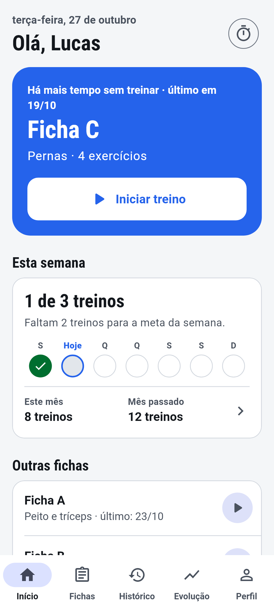 | 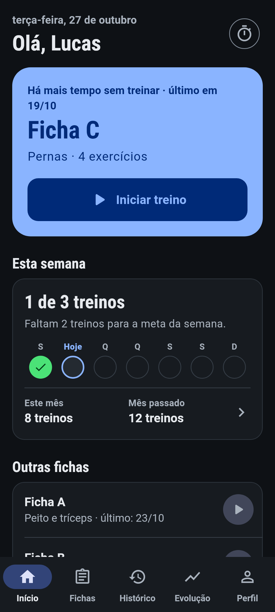 |
| 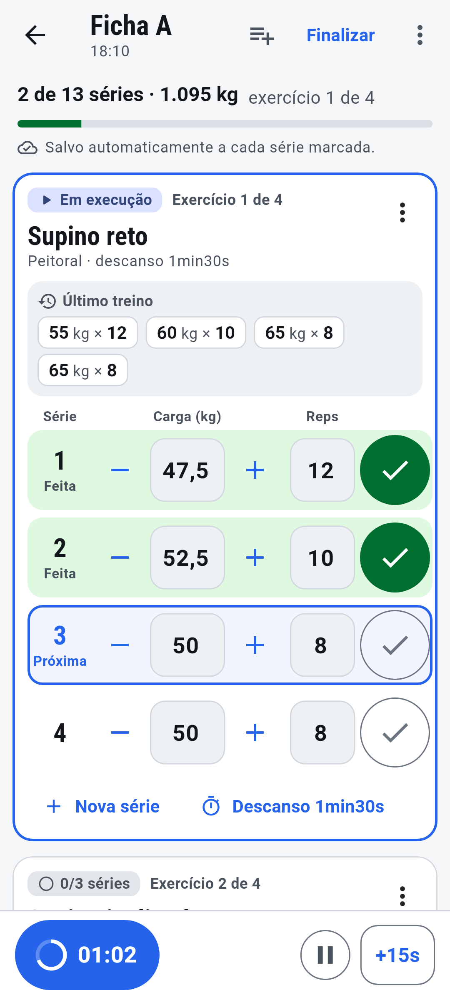 | 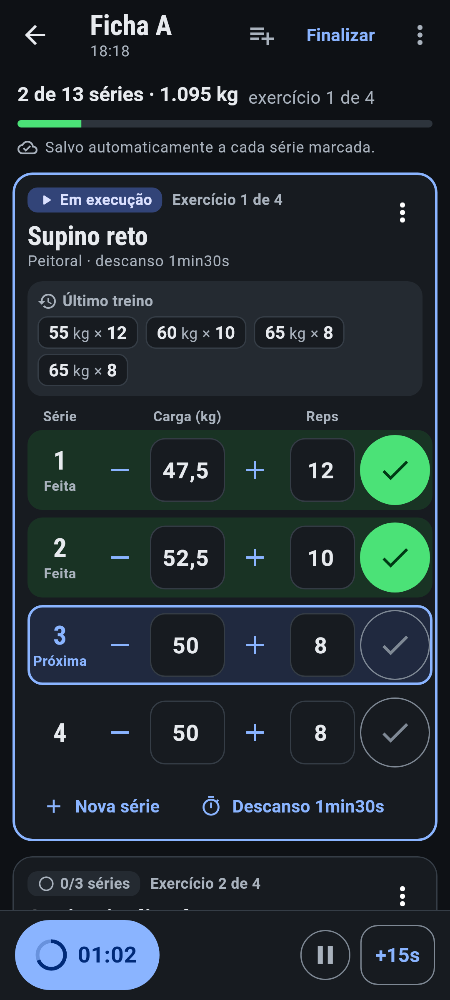 |
| 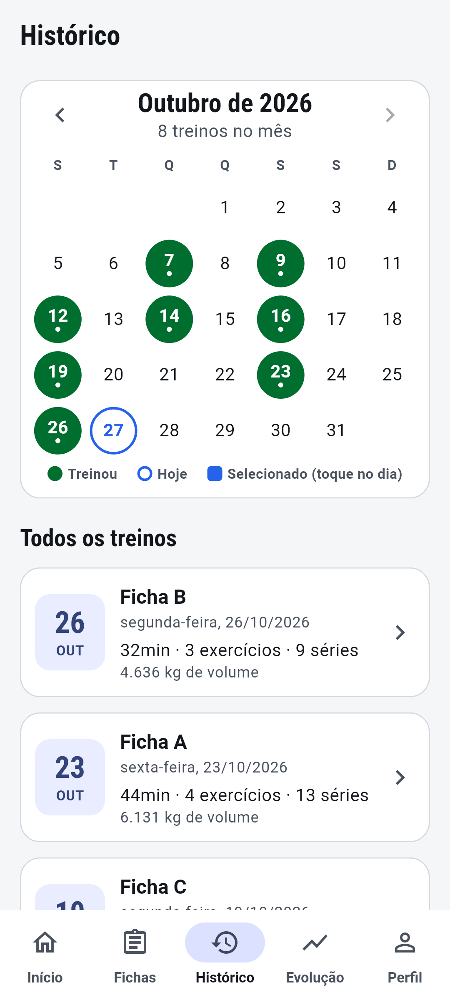 | 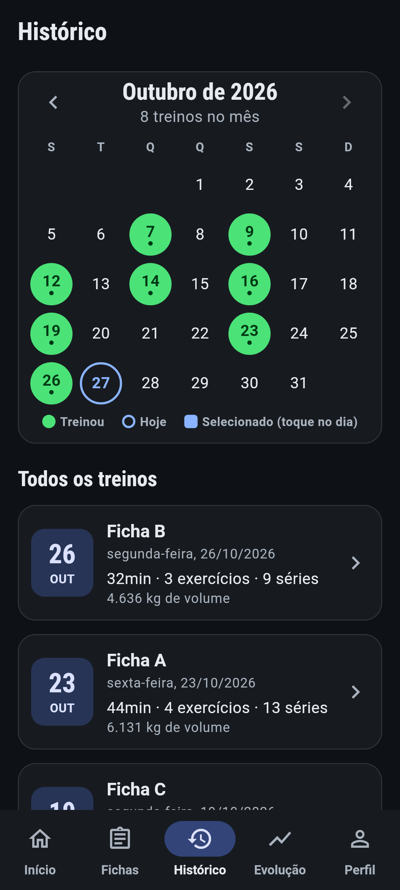 |
| 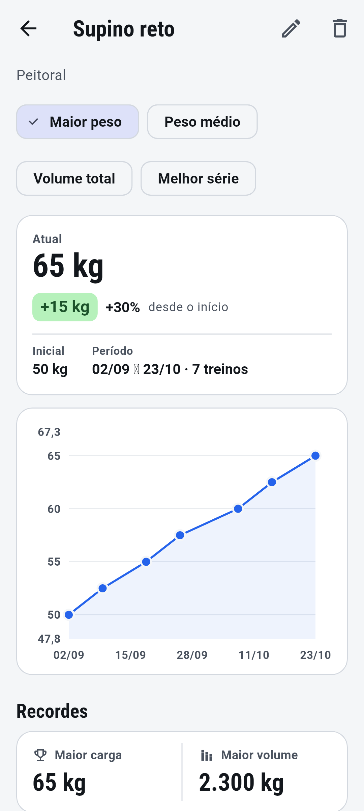 | 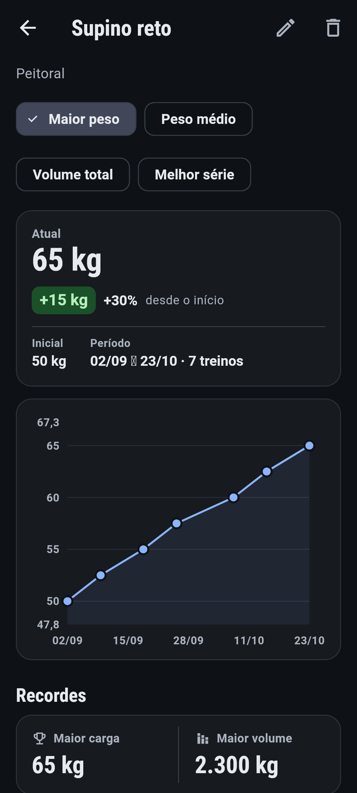 |

Capturas anteriores (histórico, antes do redesenho) em
[`docs/screenshots/`](docs/screenshots/):

| Claro | Escuro |
|---|---|
| 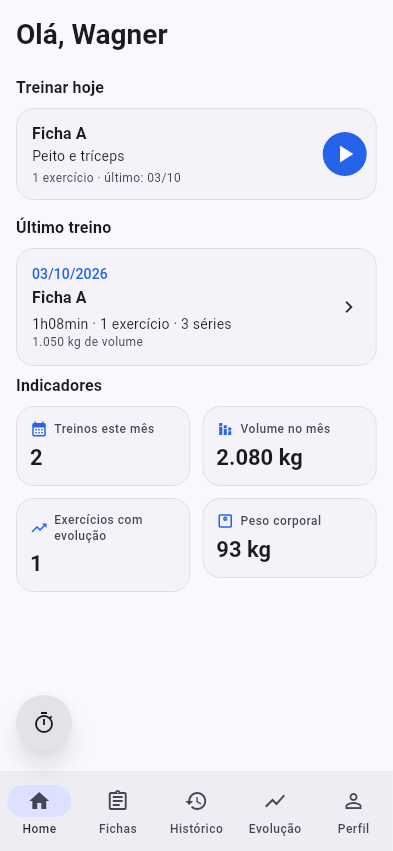 | 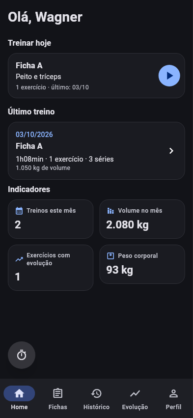 |
| 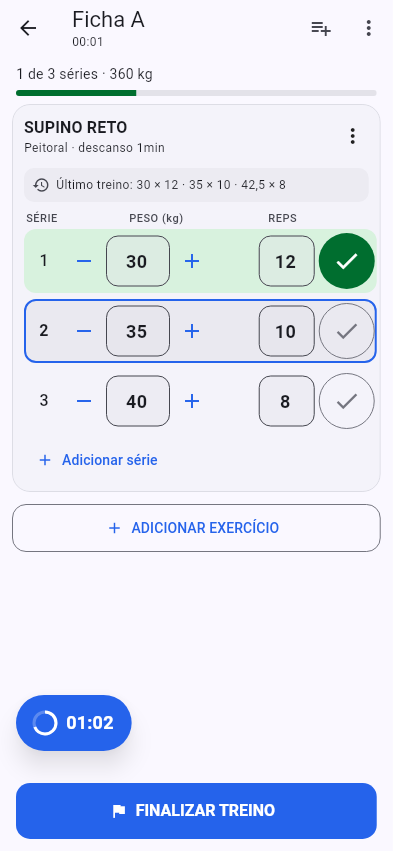 | 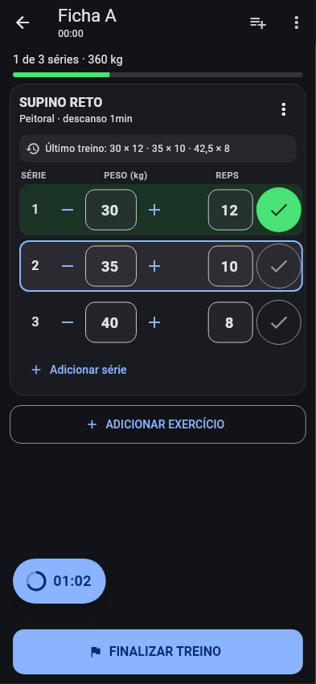 |
| 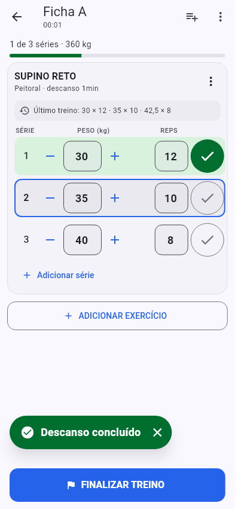 | 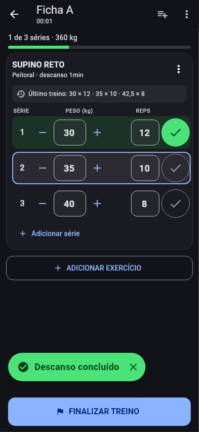 |

## Ícone

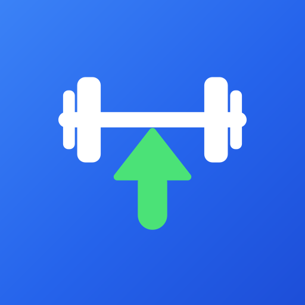

Uma barra com anilhas (**Train**) levantada por uma seta para cima (**Up**),
em branco e verde de progresso sobre o azul elétrico da marca. Juntas, as
formas lembram um "T". O ícone não tem texto, pois o nome ficaria ilegível
nos tamanhos pequenos (diretriz das duas lojas).

Todos os arquivos são gerados por um único script, a partir da mesma
geometria (requer `python3-cairo`):

```bash
python3 tool/generate_icons.py
```

| Saída | Onde |
|---|---|
| Android 8+: ícone adaptativo vetorial (fundo, frente e camada monocromática para ícones temáticos do Android 13+) | `android/app/src/main/res/drawable/ic_launcher_*.xml`, `mipmap-anydpi-v26/` |
| Android 7: PNGs por densidade | `android/app/src/main/res/mipmap-*/ic_launcher.png` |
| iOS: 19 tamanhos, sem canal alfa (exigência da Apple) | `ios/Runner/Assets.xcassets/AppIcon.appiconset/` |
| Google Play: 512 × 512, PNG 32 bits | `docs/branding/trainup-icon-play-512.png` |
| App Store: 1024 × 1024, sem alfa | `docs/branding/trainup-icon-appstore-1024.png` |
| Vetor mestre para design | `docs/branding/trainup-icon.svg` |
| Prancha de revisão (máscaras, tamanhos pequenos, ícone temático) | `docs/branding/trainup-icon-preview.png` |

O símbolo ocupa a mesma proporção visual em todas as máscaras e fica dentro da
zona segura de 66 dp do ícone adaptativo, então nenhum formato de fabricante
o corta.

## Tecnologias

| Pacote | Uso |
|---|---|
| Flutter 3.47 / Dart 3.13 | SDK |
| `material_ui` | Material 3 (biblioteca oficial desacoplada do framework; ver decisões) |
| `flutter_riverpod` 3 | Estado e injeção de dependências |
| `go_router` 18 | Navegação (com `StatefulShellRoute` para as abas) |
| `drift` + `drift_flutter` | SQLite tipado, streams reativas e migrations |
| `fl_chart` | Gráficos de linha |
| `intl` | Datas e números em pt-BR |
| `drift_dev`, `build_runner` (dev) | Geração de código do banco |

Nenhum plugin nativo além do SQLite (via `drift_flutter`/`sqlite3`).

## Como executar

```bash
flutter pub get
dart run build_runner build   # só se alterar tabelas (o .g.dart já está versionado)
flutter run
```

### Qualidade

```bash
dart format .
flutter analyze
flutter test
```

> **Hosts Linux com glibc < 2.33 (ex.: Ubuntu 20.04):** a biblioteca SQLite
> pré-compilada que o pacote `sqlite3` usa nos testes não carrega nesses
> sistemas. Rode os testes em container com `tool/docker_test.sh` (usa o
> mesmo Flutter SDK e pub-cache do host):
>
> ```bash
> tool/docker_test.sh            # = flutter test
> tool/docker_test.sh test test/unit
> ```
>
> Isso afeta só os testes no host; os builds Android/iOS não mudam.

## Build

**Android**

```bash
flutter build apk --release        # APK
flutter build appbundle --release  # AAB para a Google Play
```

Identificador: `br.com.trainup.app`. O release é assinado com a **chave de
envio** da Play Store, lida de `android/key.properties` (keystore em
`android/keystore/`, ambos fora do controle de versão). Sem esse arquivo, o
build usa a chave de debug e mostra um aviso — a Play rejeita esse pacote.

Passo a passo da publicação, textos da loja e respostas do Play Console:
[docs/play-store/README.md](docs/play-store/README.md). Política de
privacidade: tela no app e [docs/legal/politica-de-privacidade.html](docs/legal/politica-de-privacidade.html).

**iOS** (requer macOS + Xcode)

```bash
cd ios && pod install && cd ..
flutter build ipa --release
```

Configure o Team/Bundle Identifier no Xcode (`ios/Runner.xcworkspace`).

## Estrutura de pastas

```
lib/
  main.dart                 # abre o banco, carrega estado inicial, runApp
  app.dart                  # MaterialApp.router, tema, overlay do timer
  core/
    database/               # tabelas, AppDatabase (migrations), seed, provider
    router/                 # rotas, GoRouter, AppShell (barra inferior)
    theme/                  # tema Material 3 claro/escuro
    utils/                  # formatação pt-BR, validações, relógio, feedback
    widgets/                # EmptyState, ConfirmationDialog, StatTile...
    extensions/
  features/
    profile/                # perfil, onboarding
    body_measurements/      # histórico de medidas
    exercises/              # catálogo
    workout_plans/          # fichas (planejamento)
    workouts/               # sessões (execução), histórico, resumo
    progress/               # evolução de cargas, gráficos, dashboard
    timer/                  # temporizador global
    settings/               # configurações
    home/                   # dashboard
test/
  unit/                     # cálculos, formatação, validações, timer
  data/                     # repositórios sobre SQLite em memória
  widget/                   # fluxos completos de interface
drift_schemas/              # snapshots do schema para migrations
docs/architecture.md        # entidades, fluxos e decisões
```

Cada feature segue `data/` (repositórios Drift + providers), `domain/`
(modelos e regras puras, testáveis sem Flutter) e `presentation/` (telas e
widgets).

## Banco de dados

SQLite via Drift, arquivo `trainup.sqlite` no diretório de documentos do
app. Chaves estrangeiras ativas (`PRAGMA foreign_keys = ON`), constraints
`CHECK` (peso ≥ 0, reps ≥ 0, gordura 0–100, altura plausível...) e índices em
`workout_session_id`, `workout_plan_id`, `exercise_id`, `started_at` e `date`.

**Migrations:** `schemaVersion` começa em 1 e o `onUpgrade` aplica passos
incrementais (`_migrateStep`), lançando erro para versões desconhecidas — o
banco **nunca é recriado** automaticamente. Para evoluir o schema:

1. altere as tabelas e incremente `schemaVersion`;
2. adicione o `case` correspondente em `_migrateStep`;
3. rode `dart run drift_dev make-migrations` (gera o snapshot e testes de
   migração a partir de `drift_schemas/`).

Detalhes do modelo em [docs/architecture.md](docs/architecture.md).

## Principais decisões técnicas

- **Ficha ≠ treino executado.** Iniciar um treino copia exercícios e séries da
  ficha para tabelas de sessão (com snapshot de nome da ficha e do exercício).
  Editar/excluir fichas ou renomear exercícios nunca altera o histórico.
- **Peso e medidas fora do perfil.** O perfil guarda só dados estáveis; peso
  atual = medição mais recente. Assim todo registro vira histórico.
- **Soft delete** para fichas e exercícios já usados (`is_active`).
- **Timer sem contador em background.** Persistimos `status`, `duration`,
  `startedAt` e `elapsedBefore` (tempo acumulado antes de pausas) e calculamos
  o restante pelo relógio. Um único `Timer.periodic` global atualiza a UI só
  enquanto conta.
- **`material_ui` em vez de `package:flutter/material.dart`.** No Flutter 3.47
  o Material foi desacoplado para o pacote oficial `material_ui`, e o
  `go_router` 18 já depende dele. Usar o mesmo pacote no app inteiro evita dois
  sistemas de tema/localização paralelos.
- **Riverpod sem geração de código** (providers manuais) para reduzir
  dependências e build steps.
- **Unidade de peso preparada para lb**: tudo é armazenado em kg; o enum
  `WeightUnit` converte só na apresentação (hoje só kg está habilitado).

## Limitações conhecidas

- **Som do timer:** o sinal "bip-bip-biiip" é próprio do app
  (`tool/generate_rest_sound.js`) e toca como alarme, com `audioplayers`, ou
  seja, sai mesmo com o volume de mídia baixo. A música de outros apps só
  abaixa enquanto ele toca. No iPhone, a notificação com a tela bloqueada
  usa o som padrão do sistema.
- **Aviso com o celular bloqueado:** usa `flutter_local_notifications`. No
  Android 13+ o app pede a permissão de notificações no primeiro descanso. No
  Android 14+, "Alarmes e lembretes" vem negado por padrão; sem ele o aviso
  pode atrasar. O app mostra um aviso com o botão PERMITIR nas Configurações e
  na tela do temporizador.
- **Importar fichas** usa o seletor de arquivos do sistema: o aluno salva o
  arquivo recebido (ex.: WhatsApp > Salvar em Downloads) e o escolhe. Abrir o
  arquivo direto pelo WhatsApp ("Abrir com TrainUp") ainda não é suportado.
- Ainda não validado em aparelho físico/emulador nesta etapa (veja o resumo de
  entrega).
